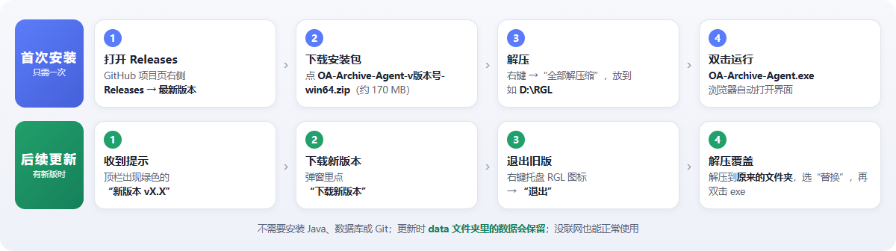
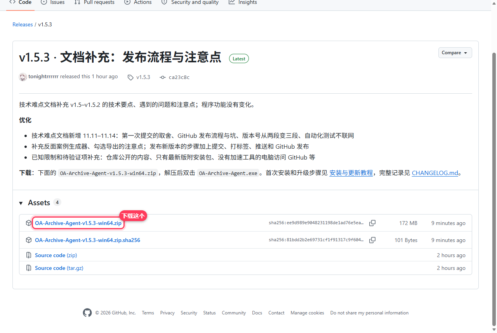
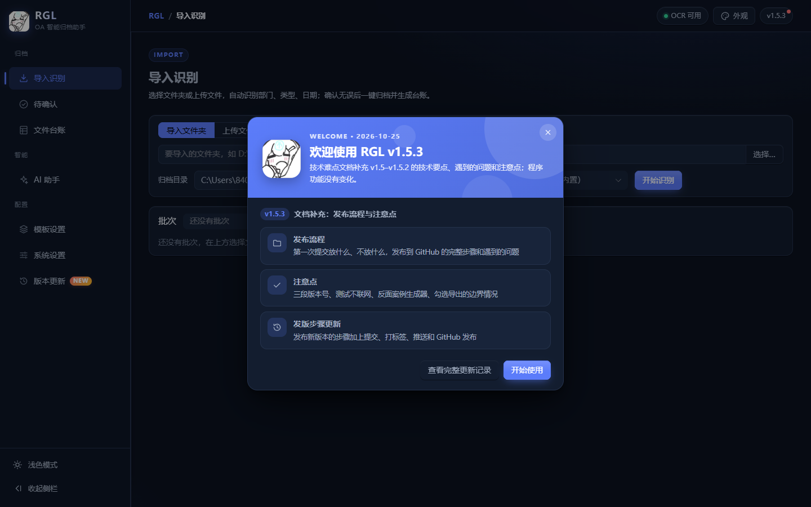
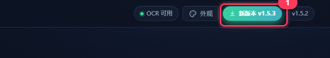
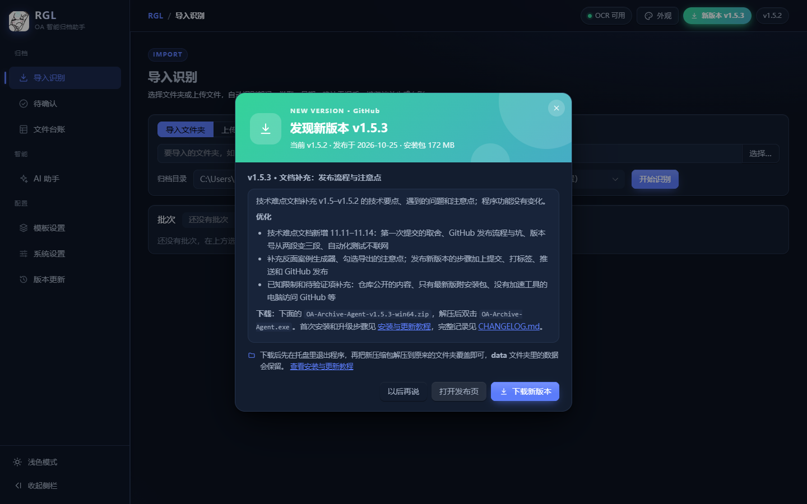
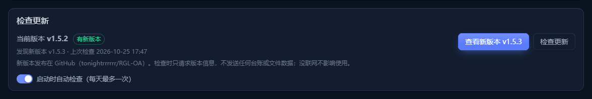
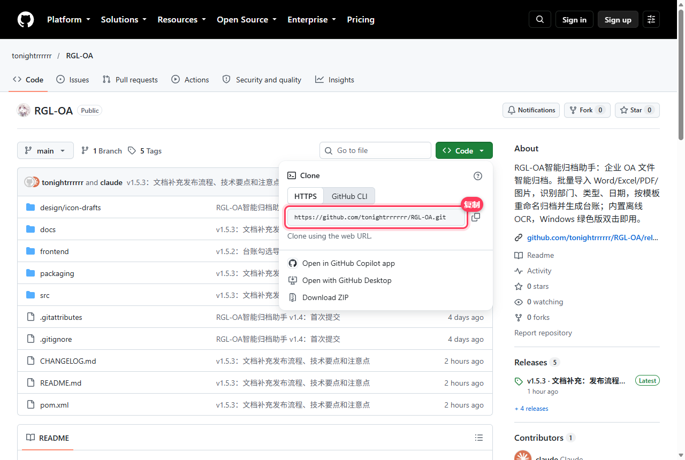

# RGL-OA智能归档助手

简称 RGL。参赛题目：企业OA文件智能归档智能体。

批量导入本地办公文件（Word、Excel、PDF、图片），自动识别部门、文件类型、日期，按模板重命名并归档到指定目录，生成可搜索、可导出 Excel 的文件目录台账。完全离线运行，内置 OCR。

详细设计见 [docs/技术文档-v1.0-项目启动.md](docs/技术文档-v1.0-项目启动.md)，开发中遇到的难题和解决办法见 [docs/技术难点与解决方案.md](docs/技术难点与解决方案.md)。

项目周期：2026 年 10 月 10 日立项，10 月 27 日发布 v1.7.2。

## 安装与更新（图文教程）



不需要安装 Java、数据库或 Git，下载解压就能用。更详细的说明（回退旧版、常见问题）见 [安装与更新教程](docs/安装与更新教程.md)。

### 普通用户：第一次安装

**① 下载**：打开 [Releases 最新版本](https://github.com/tonightrrrrrr/RGL-OA/releases/latest)，在 Assets 里点 `OA-Archive-Agent-v1.7.2-win64.zip`（约 170 MB）。不要点下面的 Source code，那是源码。



**② 解压**：右键 zip →“全部解压缩”，放到一个能写入的文件夹，例如 `D:\RGL`。

**③ 运行**：双击 `OA-Archive-Agent.exe`，等 10 秒左右，浏览器会自动打开界面，右下角托盘出现 RGL 图标。第一次打开会显示欢迎公告。



> Windows 提示“已保护你的电脑”时，点“更多信息”→“仍要运行”。关掉浏览器页面不会退出程序，要退出请右键托盘图标 →“退出”。

### 普通用户：后续更新

**① 收到提示**：有新版本时，程序右上角会出现绿色的“新版本”按钮（程序每天自动检查一次，没联网时不提示、也不影响使用）。



**② 下载新版本**：点这个按钮，在弹窗里点“下载新版本”。



**③ 退出旧版**：右键托盘里的 RGL 图标 →“退出”。

**④ 解压覆盖**：把新压缩包解压到**原来的文件夹**，提示同名文件时选“替换”，再双击 `OA-Archive-Agent.exe`。数据都在 `data` 文件夹里，覆盖时会保留。

也可以在“系统设置 → 检查更新”里随时手动检查：



### 开发者：拉取项目

需要 JDK 17、Maven 3.8+ 和 Git。Node.js、pnpm 由 Maven 自动下载。

在项目首页点绿色的 **Code** 按钮，复制仓库地址：



```bash
git clone https://github.com/tonightrrrrrr/RGL-OA.git
cd RGL-OA
mvn package -DskipTests
java -jar target/oa-archive-agent.jar
```

浏览器打开 <http://127.0.0.1:18080> 即可使用。

### 开发者：后续更新

```bash
cd RGL-OA
git pull
mvn package -DskipTests
```

切换到某个版本：`git tag` 列出全部版本，`git checkout v1.7.2` 切换过去，`git checkout main` 回到最新代码。

### 其他

- 启动有问题时运行 `OA-Archive-Agent-Debug.exe`，可以在窗口里看到日志；日志也保存在 `data/logs/`。
- 升级后资源管理器还显示旧图标时，运行 `ie4uinit.exe -show` 刷新图标缓存。
- 每个版本更新了什么，见程序侧栏的“版本更新”或 [CHANGELOG.md](CHANGELOG.md)。

## 版本

安装和升级步骤见 [docs/安装与更新教程.md](docs/安装与更新教程.md)；除了 10 份成功示例，还有一组“反面案例”演示各种失败情况，见 [docs/反面案例说明.md](docs/反面案例说明.md)。各版本的更新内容见 [CHANGELOG.md](CHANGELOG.md)。程序版本和 [docs/技术难点与解决方案.md](docs/技术难点与解决方案.md) 的文档版本保持一致，每次更新一起升级。版本记录在 `src/main/resources/changelog.json`；发布新版本的步骤见文档第 11 章，`VersionSyncTest` 会检查各处版本号是否一致。

## AI 助手“小R”（可选）

在侧栏打开“AI 助手”，点“连接设置”，填写 OpenAI 兼容的接口地址、API Key 和模型名，测试连接后保存，就可以用对话查询台账、统计文件、调整模板、修正识别结果、导出台账。支持 GPT、DeepSeek、通义千问、智谱、Kimi、Ollama 本地模型和中转站。

- 修改类的操作只会生成确认卡片，点“确认执行”后才生效；归档、撤销、删除不交给 AI，要在对应页面手动操作。
- 开启后，问题和查到的台账字段会发送到填写的接口地址；文件正文默认不发送。
- API Key 只保存在本机的 `data/config/ai.json`，界面上打码显示。
- 不配置时，程序的其他功能完全离线运行。

设计和难点见 [docs/技术难点与解决方案.md](docs/技术难点与解决方案.md) 第 10 章。

## 开发

环境：JDK 17、Maven 3.8+。Node 和 pnpm 由 Maven 插件自动下载，不需要本机安装。

| 场景 | 命令 |
| --- | --- |
| 运行全部测试 | `mvn test -Dskip.frontend=true` |
| 构建 jar（含前端） | `mvn package -DskipTests` |
| 启动后端（开发模式） | `java -Dspring.profiles.active=dev -jar target/oa-archive-agent.jar` |
| 前端热更新 | `cd frontend` 后执行 `pnpm install`、`pnpm dev`，打开 http://127.0.0.1:5173 |
| 打包绿色版 | `powershell -ExecutionPolicy Bypass -File packaging/package.ps1` |

打包脚本会自动下载 Temurin 17 到 `packaging/.jdk`（已校验 SHA-256），产物在 `release/`。

## 目录

```text
src/main/java/com/yizhaoqi/oaarchive/
  launcher/   启动器：数据目录、单实例、端口、托盘、中文临时目录保护
  importer/   文件夹扫描与过滤
  parser/     Word / Excel / PDF / 图片解析，统一文档模型，文本清洗
  ocr/        RapidOCR（PP-OCRv4）封装
  recognize/  区域切分、部门 / 类型 / 日期 / 标题识别
  template/   模板与命名渲染
  archive/    归档、撤销、档号
  ledger/     台账查询与 Excel 导出
  pipeline/   处理流水线、进度推送
  ai/         AI 助手：连接设置、模型客户端、工具、对话、待确认的修改
frontend/     Vue 3 + Naive UI 界面
packaging/    绿色版打包脚本
design/       图标草图与生成脚本（icon-drafts/crop.py --final p1 导出程序图标）
docs/         技术文档、技术难点与解决方案
```
